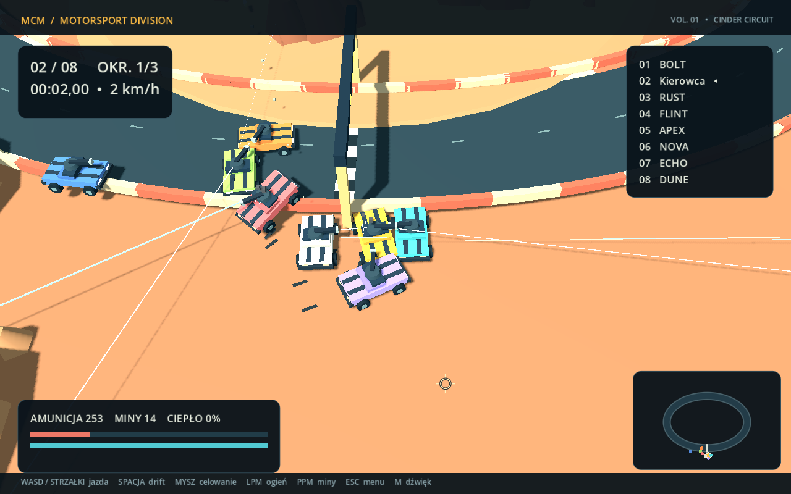

# Mini Car Mayhem 3D

[](https://github.com/sophiesticated94/brute-racing/actions/workflows/ci.yml)

Autorska wyścigowa gra bojowa: Godot **4.7 .NET**, **Jolt**, C#. Jeden tor 3D,
samochód Rook w ośmiu kolorach, karabin, laser, rakiety, miny i do siedmiu rywali.
Kampania pokoju, rozwój w garażu i szybki multiplayer dobierany według siły archiwalnego buildu.
Menu → lobby → odliczanie → trzy okrążenia → podium → garaż / rewanż.



## Uruchomienie na Windows

Wymagany **PowerShell 7**, SDK .NET **10.0.400** i możliwość pobierania pakietów NuGet.
Silnik i szablony eksportu są lokalne, w ignorowanym `.tools/`.

```powershell
./scripts/setup.ps1                  # pobiera oficjalny Godot 4.7 .NET
./scripts/run.ps1                    # menu
./scripts/run.ps1 -Solo              # gracz + 3 boty
./scripts/local-play.ps1 -Clients 1  # dwa okna: host i klient
```

Gotowe eksporty powstają w `artifacts/windows/` i `artifacts/linux/`.
Uruchom `MiniCarMayhem.exe` albo `MiniCarMayhem.x86_64` z całym folderem eksportu;
katalog z bibliotekami .NET jest częścią gry. Na Linux nadaj plikowi wykonywalnemu
uprawnienia `chmod +x MiniCarMayhem.x86_64`. Nie jest potrzebny osobny backend.
Eksport zawiera runtime .NET i używa stałego formatowania liczb, dzięki czemu nie
wymaga instalowania ICU na Linux.

## Sterowanie

| Akcja | Klawiatura / mysz | Pad |
|---|---|---|
| Gaz / hamowanie i wsteczny | W / S, góra / dół | RT / LT |
| Skręt względem auta | A / D, lewo / prawo | Lewa gałka |
| Celowanie wieżyczką | Kursor na torze | Prawa gałka |
| Broń główna | LPM | RB |
| Mina | PPM | LB |
| Drift | Spacja | A |
| Menu opuszczenia wyścigu | Esc | — |
| Wyciszenie | M | — |
| Zrzut ekranu do danych użytkownika | F12 | — |

Gaz i wsteczny są zależne od kierunku auta, kamera zachowuje orientację świata.
Esc otwiera menu, ale **nie zatrzymuje wspólnej symulacji**. Ochrona po respawnie
trwa 2 sekundy, uzupełnia się uzbrojenie. Laser regeneruje energię; przegrzany
musi ostygnąć poniżej 30%. Karabin i rakiety mają ograniczoną amunicję.

## Kampania, garaż i quick

Menu uruchamia kampanię solo z trzema botami albo pokój kampanii po IP. Host
wybiera 3–10 wyścigów (domyślnie 6). Każda nowa kampania zaczyna się od bazowego
Rooka, uzbrojenia poziomu 1 i 0 SP. XP, kredyty oraz zakupy są zarządzane przez
hosta. Po podium otwiera się lobby z garażem: kupuj poziomy broni, wydawaj SP w
30 węzłach pięciu specjalizacji, zgłoś gotowość i rozpocznij kolejny wyścig.
Graf przesuwa się prawym/środkowym przyciskiem myszy, kółko zmienia skalę.
Bezpłatny reset SP wymaga potwierdzenia. Broń ma pięć poziomów i perki:
penetrację pancerza, przebicie laserem, salwę rakiet oraz miny z EMP.

Kampania daje trwałe monety na kosmetykę i końcowy build do zapisania w jednym
z trzech slotów archiwum. Archiwum wybiera się do quick. Nowy profil zawiera
trzy bazowe presety, więc można zacząć od razu. Kolory i kosmetyki nie zmieniają
statystyk. Następna kampania ponownie resetuje rozwój, zachowując profil i archiwum.

Quick wymaga adresu uruchomionego katalogu HTTP(S). Katalog sam waliduje build
i oblicza fitness według wag JSON. Szuka do 8 ludzi, celuje w 4; od 2 może zacząć
po 15 sekundach. Tolerancja rośnie z 10% co 10 s do 25%. Quick nie dodaje botów.
Przed startem wszyscy potwierdzają rzeczywiste połączenie ENet z wybranym hostem;
nieudana oferta wraca do kolejki. Przycisk anulowania usuwa wpis.

```powershell
./scripts/run.ps1 -Solo -Mode Campaign -CampaignRaces 6
./scripts/run.ps1 -HostGame -Mode Campaign -CampaignRaces 3
./scripts/directory.ps1  # osobny terminal, http://127.0.0.1:5080
./scripts/run.ps1 -Mode Quick -DirectoryUrl http://127.0.0.1:5080 -Port 28747
```

Publiczny katalog nie jest wdrożony w tym repozytorium; można uruchomić własny
lokalnie lub w kontenerze. Instrukcja: [docs/directory.md](docs/directory.md).
Kampania i bezpośrednie IP działają bez niego. Dotychczasowe flagi i `-Solo`
bez `-Mode` zachowują pojedynczy wyścig / `--rounds` rewanżów.

Profil `user://profile.json` ma wersję, sumę SHA-256, zapis atomowy i `.bak`.
Uszkodzony plik zostaje zachowany, a gra próbuje odzyskać kopię. Nieznana nowsza
wersja nie jest nadpisywana. `--smoke` używa pamięci; jawne `--profile-path=...`
pozwala sprawdzić izolowany zapis. Host weryfikuje poprawność i siłę archiwum,
ale bez kont / backendu nie potwierdza historii jego zdobycia.

## Multiplayer

Host wybiera liczbę botów, broń i kolor, następnie tworzy pokój. Klient podaje IP
i port (domyślnie **28747/UDP**). W lobby można zmienić broń i lakier; zmiana cofa
gotowość. Host startuje po zgłoszeniu gotowości przez wszystkich. Dołączenie
człowieka do pełnego lobby zastępuje bota. Minimum wyścigu sieciowego: 2 auta,
maksimum: 8. Podczas wyścigu nie można dołączać. Rozłączone auto przejmuje AI.

W LAN użyj adresu lokalnego gospodarza. Internet wymaga osiągalnego portu UDP
(przekierowanie routera / opcjonalne UPnP oraz reguła zapory). Gra nie udaje, że
katalog kodów pokoi rozwiązuje CGNAT: relay i Steam są kolejnymi etapami.

```powershell
./scripts/run.ps1 -HostGame -Bots 3
./scripts/run.ps1 -Join 192.168.1.10 -Port 28747
./scripts/run.ps1 -HostGame -Headless
```

Headless ze zwykłym `-HostGame` również ma lokalne miejsce gracza; do automatycznego
hosta bez lokalnego kierowcy służą argumenty silnika `-- --host --dedicated --autostart`.

## Budowanie i sprawdzanie

```powershell
./scripts/build.ps1
./scripts/test.ps1
./scripts/integration.ps1 -Impaired -Combat
./scripts/integration.ps1 -Dedicated -Rounds 2 -Port 29848
./scripts/connection-tests.ps1
./scripts/integration.ps1 -Campaign -Impaired -Combat -Port 29860
./scripts/quick-integration.ps1 -UnreachableHost
./scripts/quick-integration.ps1 -Players 4 -DirectoryPort 5088 -GamePort 29930
./scripts/setup.ps1 -ExportTemplates  # pobiera ok. 1,2 GB
./scripts/export.ps1
```

Test integracyjny uruchamia prawdziwe procesy Godota. Sprawdza wspólne podium,
czasy, zaliczone bramki i liczbę zdarzeń. Klienci próbują także podszyć się pod
hosta przez sfałszowane snapshoty, zdarzenia i podium; host je ignoruje.
`connection-tests.ps1` sprawdza przejęcie rozłączonego gracza przez AI i utratę hosta.
`-Impaired` dodaje po 50 ms opóźnienia
w obu kierunkach i odrzuca 3% pakietów zawodnych. Pakiety niezawodne pozostają
obsługiwane przez ENet. Raporty JSON i logi trafiają do `artifacts/tests/`.

Szybki test solo, bez czasu rzeczywistego:

```powershell
$godot = (Get-ChildItem .tools/godot -Recurse -Filter '*console.exe' | Select-Object -First 1).FullName
& $godot --headless --path src/Game.Client --fixed-fps 60 -- --smoke --bots=7
```

`--fixed-fps` przyspiesza symulację i **nie mierzy płynności renderowania**.
Raport rozdziela czas symulacji od rzeczywistej częstotliwości klatek.
Diagnostyka: `--timeout=210`, `--no-weapons`, `--weapon=laser`, `--rounds=2`,
`--results=C:/absolute/report.json`, `--screenshot=C:/absolute/frame.png`.

## Architektura i zakres

- `src/Game.Core`: niezależne od silnika statystyki, definicje, walidacja buildów,
  checkpointy, ranking, zegar wyścigu, protokół i przybliżony model predykcji.
- `src/Game.Client`: fizyka Jolt, autorytatywna sesja, transport ENet, boty,
  proceduralne modele, tor, polskie UI i syntetyzowane dźwięki.
- `data`: źródłowe JSON-y kopiowane do projektu podczas budowania.
- `src/Game.DirectoryApi`: opcjonalny katalog ASP.NET Core 10, kolejka i oferty w pamięci.
- `tests/Game.Core.Tests`: testy xUnit. `.github/workflows/ci.yml`: build, testy,
  wyścigi procesów i eksporty.

Opis obecnego kodu: [architektura](docs/architecture.md),
[sieć](docs/networking-p2p.md), [wyniki i granice weryfikacji](docs/verification.md).
Oryginalne dokumenty projektowe pozostają w `doc/`; uzgodnione zasady dwóch trybów
opisuje ten README. Relay, Steam, migracja hosta oraz synchronizacja profili w
chmurze pozostają kolejnymi etapami.
